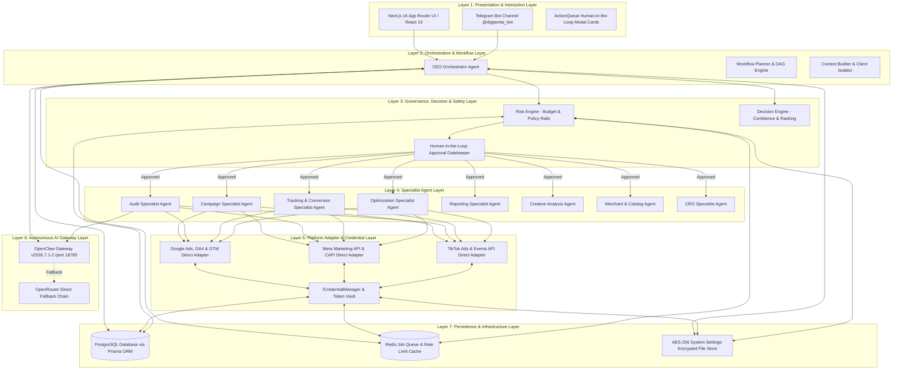

# Architecture Document 01: System Architecture
## 7-Layer Enterprise Stack & Direct API Integration Architecture

**Version:** 2.0.0 (Direct Platform API Revised)  
**Governance:** Enterprise Agentic Architecture (Phase 1 Deliverable)  
**Security Standard:** Strict Zero-Credential Leakage & Client-Isolated Execution

---

### 1. The 7-Layer Architectural Stack

DigiPort is structured as a 7-layer decoupled enterprise system where each layer has strictly defined boundaries, unidirectional dependencies, and no direct bypass mechanisms.

---

### 2. Direct Platform API Integration Model

All external communications with advertising platforms (Google Ads, Meta, TikTok) bypass third-party aggregator intermediaries and communicate directly with official platform endpoints via authenticated adapters:

1. **Google Ads Direct Adapter:**
   * **Endpoint:** `https://googleads.googleapis.com/v17/`
   * **Authentication:** OAuth2 Refresh Token exchange via Google Identity (`https://oauth2.googleapis.com/token`) signed with `GOOGLE_ADS_DEVELOPER_TOKEN` and `GOOGLE_ADS_CLIENT_ID` / `GOOGLE_ADS_CLIENT_SECRET`.
   * **Scope:** `https://www.googleapis.com/auth/adwords`, `https://www.googleapis.com/auth/analytics.readonly`, `https://www.googleapis.com/auth/tagmanager.edit.containers`.

2. **Meta Marketing API & CAPI Direct Adapter:**
   * **Endpoint:** `https://graph.facebook.com/v20.0/`
   * **Authentication:** Long-Lived System User Access Token (`META_ACCESS_TOKEN`) with `ads_management`, `ads_read`, `business_management` permissions.
   * **Server-side Tracking:** Direct HTTPS POST to `https://graph.facebook.com/v20.0/{PIXEL_ID}/events`.

3. **TikTok Marketing API & Events API Direct Adapter:**
   * **Endpoint:** `https://business-api.tiktok.com/open_api/v1.3/`
   * **Authentication:** Long-Term Advertiser Access Token (`TIKTOK_ACCESS_TOKEN`) authorized via TikTok Developer Portal with App Secret HMAC validation.

---

### 3. Credential Security & Isolation Principle

* **Zero Memory Storage:** Live API tokens, secrets, client secrets, and developer tokens are NEVER written to the AI Memory system, prompt logs, or client-facing responses.
* **Storage Invariance:** All production credentials reside exclusively in `.env.local` or inside the database encrypted via AES-256-GCM (`system_settings.enc.json` fallback).
* **Ephemeral In-Memory Token Lifecycle:** The `ICredentialManager` resolves tokens just-in-time for outgoing requests and never caches decrypted tokens beyond their explicit TTL.
* **Client Isolation:** Each client workspace operates under an isolated partition ID (`workspaceId`). Tokens for Client A are strictly unreachable by tasks executing for Client B.
