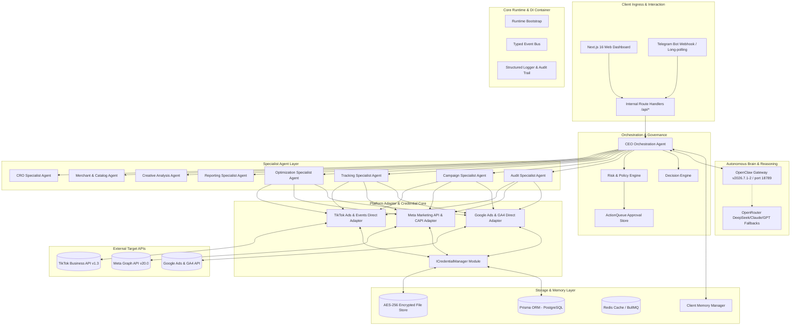
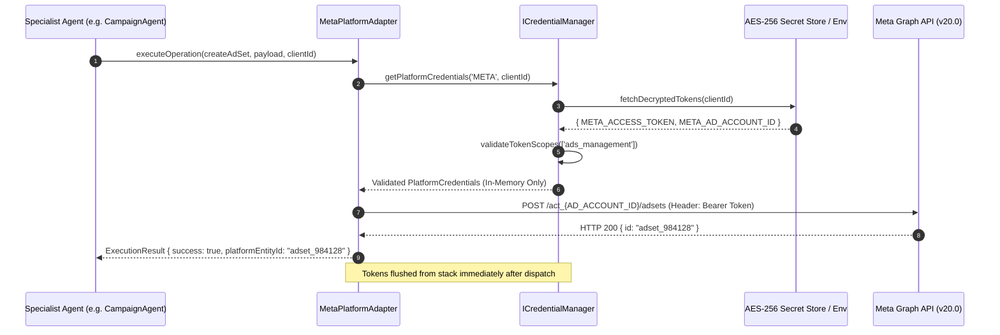

# Architecture Document 02: Component Diagram
## Component Architecture, Credential Flows & Interface Matrix

**Version:** 2.0.0  
**Phase:** 1 (Enterprise Architecture Deliverable)  
**Integration Type:** Direct Platform Adapters & Dedicated Credential Manager

---

### 1. Detailed System Component Diagram

---

### 2. Credential Flow & Authorization Lifecycle

---

### 3. Component Interface Matrix

| Source Component | Target Component | Protocol / Interface | Responsibility |
|---|---|---|---|
| **CEO Agent** | `ISpecialistAgent` | In-process TypeScript Contract | Task delegation with validated playbooks |
| **CEO Agent** | `IRiskEngine` | In-process TypeScript Contract | Safety evaluation, budget check, policy check |
| **Specialist Agents** | `IPlatformAdapter` | In-process TypeScript Contract | Normalized ad entity dispatch & metrics retrieval |
| **Platform Adapters** | `ICredentialManager` | Async In-process Contract | Retrieval and refresh of platform OAuth & system keys |
| **Platform Adapters** | Google / Meta / TikTok | Direct HTTPS REST / GraphQL | Official platform operations |
| **CEO & Specialists** | OpenClaw Gateway | HTTP/REST `/v1/chat/completions` | Complex reasoning, copy generation, analysis |
| **ICredentialManager** | Prisma / AES-256 Store | Database / Filesystem AES-GCM | Persistent encrypted credentials retrieval |
| **Risk Engine** | ActionQueue | Database State Record | Human approval card creation and resolution |
