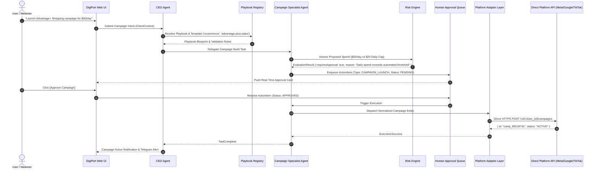
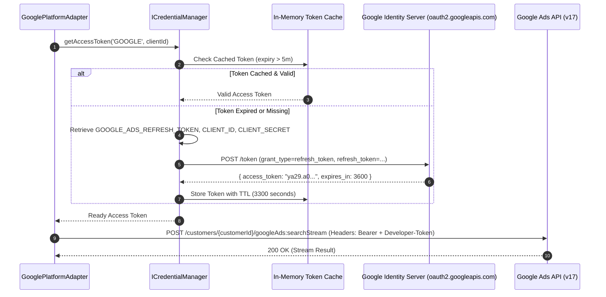
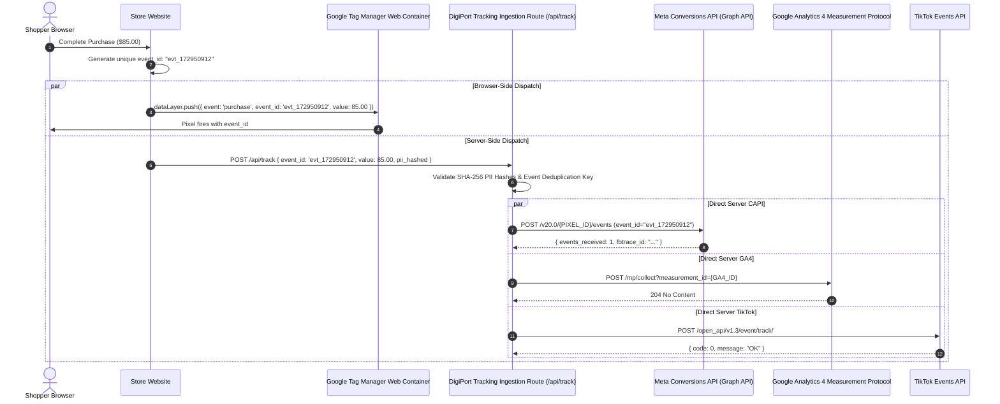
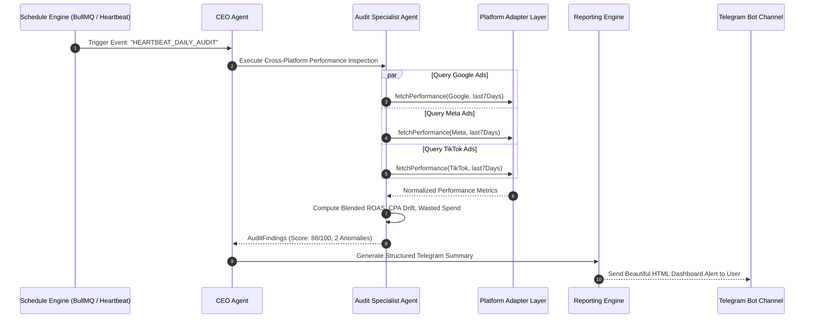
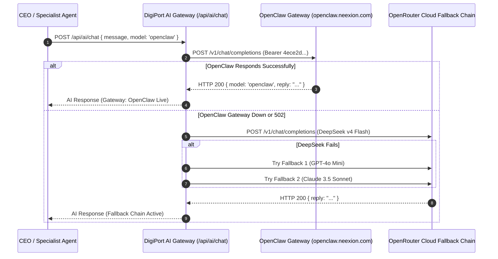
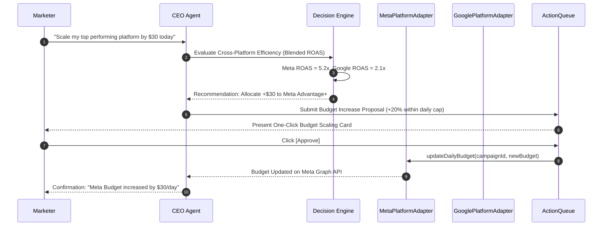

# Architecture Document 03: Execution Flow
## Complete Sequence Diagrams & OAuth Token Refresh Lifecycle

**Version:** 2.0.0  
**Phase:** 1 (Enterprise Architecture Deliverable)  
**Standard:** 7 Production Sequence Diagrams covering Direct APIs & Agent Governance

---

### Sequence 1: Campaign Creation with Human Approval Gate



---

### Sequence 2: OAuth Token Refresh Flow (Google Ads Direct)



---

### Sequence 3: Conversion Tracking & CAPI Deduplication Flow



---

### Sequence 4: Scheduled Autonomous Performance Audit (Heartbeat)



---

### Sequence 5: Emergency ROAS Drop & Budget Protection Flow

```mermaid
sequenceDiagram
    autonumber
    participant Monitor as Real-time Metric Watchdog
    participant Risk as Risk Engine
    participant CEO as CEO Agent
    participant Opt as Optimization Specialist Agent
    participant Adapter as Platform Adapter Layer
    participant User as Marketer (Telegram / UI)

    Monitor->>Risk: Alert: "AdSet_992 CPA spiked to $64 (Target: $18)"
    Risk->>Risk: Evaluate Budget Protection Policy: CRITICAL_SPIKE
    Risk->>CEO: Request Emergency Intervention (AdSet_992)
    CEO->>Opt: Formulate Containment Action
    Opt->>Opt: Prepare Action: "Pause Underperforming AdSet"
    alt Auto-Guard Enabled
        Opt->>Adapter: Dispatch PAUSE to Meta Graph API
        Adapter-->>Opt: AdSet Status Changed to PAUSED
        Opt->>User: Telegram Critical Alert: "🚨 AdSet_992 auto-paused to protect budget"
    else Manual Approval Enforced
        Opt->>User: ActionCard Dispatched: "[Pause AdSet] or [Keep Running]"
    end
```

---

### Sequence 6: OpenClaw Reasoning & Cascading Fallback Flow



---

### Sequence 7: Cross-Platform Budget Reallocation Flow


