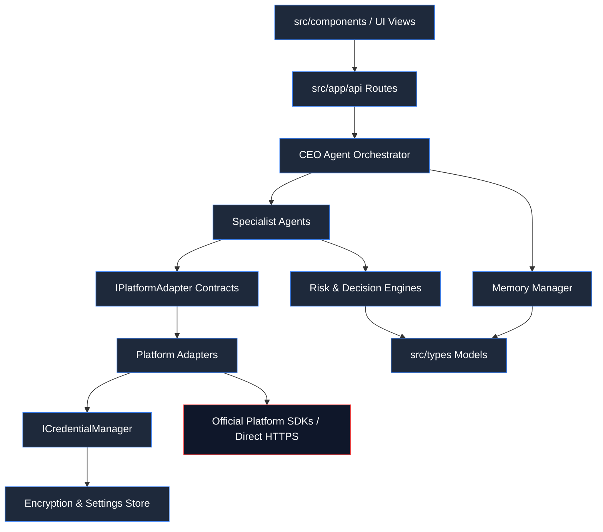
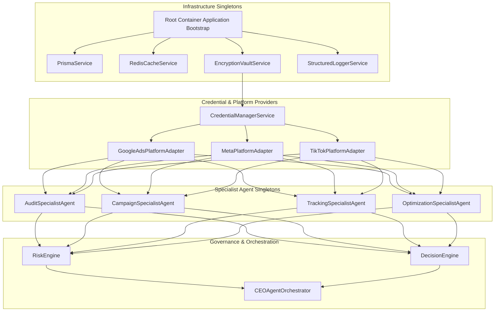

# Architecture Document 05: Dependency Graph
## Compile-Time Dependency Graph, Runtime DI Tree & SDK Isolation Rules

**Version:** 2.0.0  
**Phase:** 1 (Enterprise Architecture Deliverable)  
**Standard:** Unidirectional Architecture & Platform SDK Isolation

---

### 1. Compile-Time Dependency Graph

To prevent circular dependencies, tight coupling, and leaky platform abstractions, compile-time dependencies flow strictly downwards:

---

### 2. Runtime Dependency Injection (DI) Tree

---

### 3. Platform SDK Isolation Rules

To protect the system from breaking platform SDK updates, API deprecations, and architectural lock-in, the following strict rules are enforced:

1. **Rule 1: Direct Platform SDK Imports Forbidden in Agents:**  
   Specialist Agents, CEO Agents, and Decision Engines must NEVER import platform-specific SDKs (e.g. `google-ads-api`, `facebook-nodejs-business-sdk`, `tiktok-business-sdk`). They interact ONLY with `IPlatformAdapter`.
2. **Rule 2: Normalized Type Boundary:**  
   Any raw JSON returned by Meta Graph API, Google Ads Query Language (GAQL), or TikTok Business API must be transformed into DigiPort normalized types (`UnifiedCampaign`, `UnifiedAdGroup`, `UnifiedMetricRecord`) within the adapter before returning to the caller.
3. **Rule 3: Credential Encapsulation:**  
   Access tokens, OAuth client secrets, and developer tokens never travel beyond the `PlatformAdapter` boundary. Specialist agents only pass a `clientId` string.
4. **Rule 4: Network Isolation:**  
   External HTTPS calls to `googleads.googleapis.com`, `graph.facebook.com`, and `business-api.tiktok.com` can only be initiated from files located under `src/lib/adapters/*` or `src/lib/credential-manager.ts`.
