# Architecture Document 06: Data Flow
## Read/Write/LLM/Event Paths & Credential-Safe Data Classification

**Version:** 2.0.0  
**Phase:** 1 (Enterprise Architecture Deliverable)  
**Standard:** Strict Data Boundary & Classification Standards

---

### 1. The Four System Data Paths

```mermaid
graph TD
    subgraph "Path 1: Read Path (Metrics & State Ingestion)"
        READ_TRIGGER[Heartbeat / User View] --> READ_ADAPTER[Platform Adapters]
        READ_ADAPTER --> EXT_PLATFORMS[(Google Ads / Meta / TikTok)]
        EXT_PLATFORMS -- Raw Response --> READ_NORMALIZER[Metric Normalizer]
        READ_NORMALIZER --> PRISMA_STORE[(PostgreSQL Metrics DB)]
        PRISMA_STORE --> DASHBOARD_VIEW[Real-Time UI Dashboard]
    end

    subgraph "Path 2: Write Path (Action Execution)"
        USER_INTENT[User Action / Approved Card] --> WRITE_SPECIALIST[Specialist Agent]
        WRITE_SPECIALIST --> WRITE_RISK[Risk & Guardrail Assessment]
        WRITE_RISK --> WRITE_ADAPTER[Platform Adapter Dispatcher]
        WRITE_ADAPTER --> WRITE_CRED[ICredentialManager Auth Signer]
        WRITE_CRED --> EXT_API_MUTATION[(Platform Mutation Endpoints)]
    end

    subgraph "Path 3: LLM Reasoning Path"
        AGENT_QUERY[Agent Context & Persona Prompt] --> SANITIZER[PII & Credential Sanitizer]
        SANITIZER --> OPENCLAW_GW[OpenClaw Gateway v2026.7.1-2]
        OPENCLAW_GW -.-> OPENROUTER_FALLBACK[OpenRouter Resilient Chain]
        OPENCLAW_GW -- Structured Reasoning --> AGENT_EXEC[Agent Strategy Resolution]
    end

    subgraph "Path 4: Event Tracking Ingestion Path"
        BROWSER_PURCHASE[Website Conversion Event] --> HASHING_ENGINE[SHA-256 PII Hasher]
        HASHING_ENGINE --> DEDUP_CHECK[Event Deduplicator]
        DEDUP_CHECK --> CAPI_DISPATCH[Meta CAPI / GA4 / TikTok Dispatcher]
    end
```

---

### 2. Credential-Safe Data Classification Matrix

DigiPort enforces a 4-tier data classification model to prevent data leakage and privacy breaches:

| Tier | Category | Examples | Permitted Locations | LLM Transmission Allowed? |
|---|---|---|---|:---:|
| **Tier 1** | **Ultra-Sensitive / Credentials** | `META_ACCESS_TOKEN`, `GOOGLE_ADS_REFRESH_TOKEN`, `JWT_SECRET`, `ENCRYPTION_SECRET` | `.env.local`, Memory during active HTTP request, AES-256 encrypted storage | ❌ **STRICTLY FORBIDDEN** |
| **Tier 2** | **Customer PII (Personally Identifiable Information)** | Customer email, phone number, physical address, IP address | Ephemeral memory during conversion ingestion; must be converted to SHA-256 immediately | ❌ **FORBIDDEN (Only SHA-256 hashes allowed)** |
| **Tier 3** | **Client Business State & Strategy** | Client Name, Brand Goals, Monthly Budget, ROAS Target, Campaign Names | PostgreSQL `ClientContext`, Memory Manager, Long-term memory store | ✅ **YES (Included in prompt system context)** |
| **Tier 4** | **Normalized Metrics & Public Assets** | Spend, Impressions, Clicks, CTR, Ad Creative URLs, Copy Variations | Dashboard views, PostgreSQL, Redis cache, Reporting exports | ✅ **YES** |

---

### 3. Data Sanitization & Ingress Rules

1. **Pre-LLM Sanitization Filter:**  
   Before any message or context payload is dispatched to OpenClaw (`/v1/chat/completions`) or OpenRouter, it is passed through a regex sanitizer that scrubs potential API keys (`sk-or-v1-...`, `EAAB...`, `ya29...`), email addresses, and phone numbers.
2. **SHA-256 Normalization for Conversions:**  
   In compliance with Meta CAPI, Google Enhanced Conversions, and TikTok Events API standards, all user identifiers (email, phone) are lowercased, whitespace-trimmed, and hashed using SHA-256 (`crypto.createHash('sha256').update(val).digest('hex')`).
3. **Idempotent Ingestion Keys:**  
   Conversion events require a client-generated `event_id`. If duplicate events are received within 48 hours, the second event is discarded to maintain EMQ (Event Match Quality) integrity.
