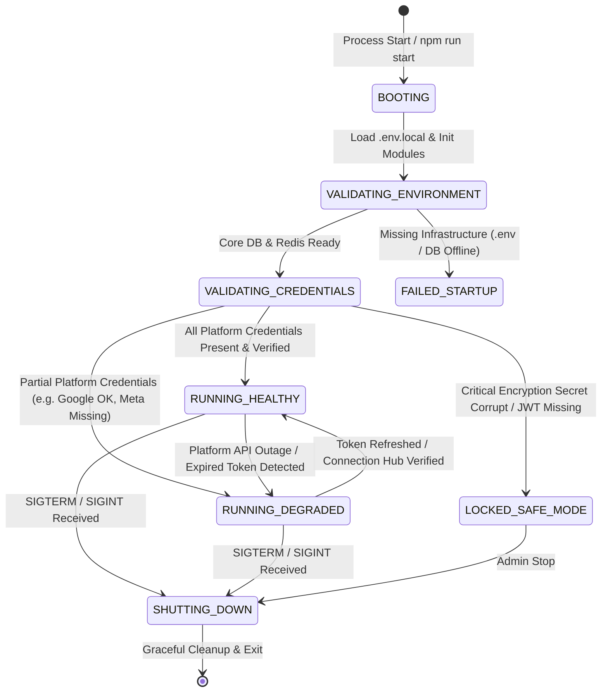
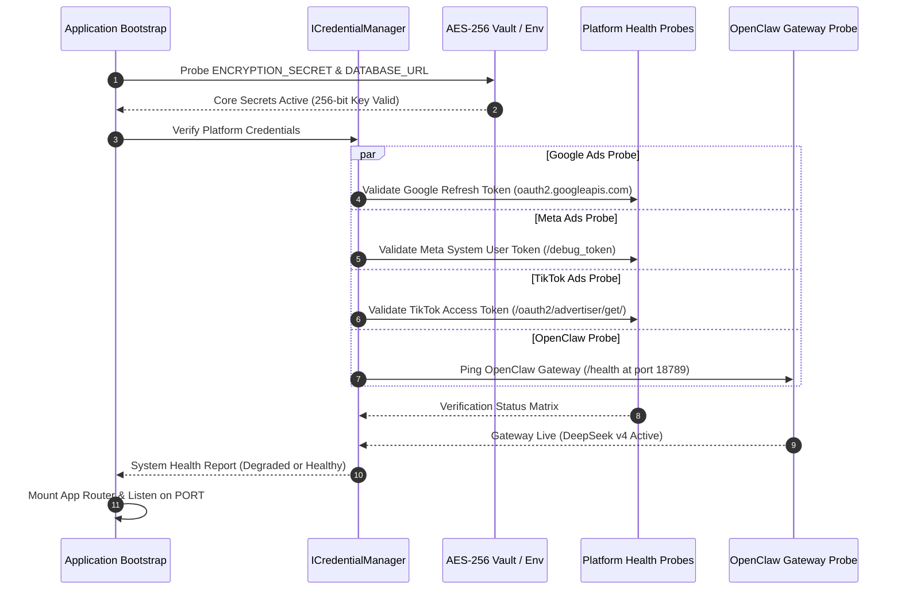

# Architecture Document 07: System Lifecycle
## System Lifecycle, State Transitions & Credential Validation Sequence

**Version:** 2.0.0  
**Phase:** 1 (Enterprise Architecture Deliverable)  
**Standard:** Resilient State Machine & Startup Verification

---

### 1. Master System State Diagram

---

### 2. Startup Credential Validation Sequence

During startup, the `SystemLifecycleManager` runs a non-destructive verification sequence:

---

### 3. Graceful Degradation & Fault Tolerance Rules

1. **Per-Platform Fault Isolation:**  
   If Meta Marketing API credentials expire or return `401 Unauthorized`, the system marks Meta as `DEGRADED`. Google Ads and TikTok campaigns continue running uninterrupted.
2. **AI Gateway Fallback:**  
   If OpenClaw VPS is temporarily unreachable, the AI Gateway automatically cascades to the direct OpenRouter fallback chain (DeepSeek v4 Flash -> GPT-4o Mini -> Claude 3.5 Sonnet) without failing user chats.
3. **Graceful Shutdown Protocol:**  
   Upon receiving `SIGINT` or `SIGTERM`, running in-flight API mutations are allowed up to 10 seconds to finish. Database connection pools and Redis queues are cleanly flushed and closed.
