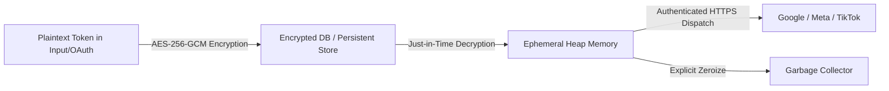

# Architecture Document 11: Security Architecture
## Credential Security, Token Lifecycle & Human-in-the-Loop Governance

**Version:** 2.0.0  
**Phase:** 1 (Enterprise Architecture Deliverable)  
**Standard:** Enterprise Grade Zero-Trust Security Standard

---

### 1. Token Security & Cryptographic Invariants

DigiPort treats advertising platform tokens as cryptographic bearer assets with the following non-negotiable invariants:

1. **Cryptographic Algorithm:** AES-256-GCM authenticated encryption (`aes-256-gcm`). Every encrypted string contains an initialization vector (IV), auth tag, and ciphertext (`${iv}:${authTag}:${encrypted}`).
2. **Key Derivation:** `ENCRYPTION_SECRET` is required to have a minimum length of 32 characters (256 bits). If weak keys are detected at startup, the system fails to boot.
3. **No Key in Repository:** Git hooks prevent accidental commits of `.env` or `.env.local`.

---

### 2. Platform Permission Scope Matrix

Each platform integration enforces minimum necessary privilege:

| Platform | Variable | Minimum Required Scopes / Permissions | Access Type |
|---|---|---|---|
| **Google Ads** | `GOOGLE_ADS_REFRESH_TOKEN` | `https://www.googleapis.com/auth/adwords` | OAuth2 Offline Access |
| **Google Analytics** | `GA4_PROPERTY_ID` | `https://www.googleapis.com/auth/analytics.readonly` | Read-only reporting |
| **Meta Marketing API** | `META_ACCESS_TOKEN` | `ads_management`, `ads_read`, `business_management` | System User Long-Lived Token |
| **TikTok Ads** | `TIKTOK_ACCESS_TOKEN` | `advertiser_management`, `ad_management`, `report_management` | App Authorized Access Token |

---

### 3. Human-in-the-Loop Guardrail (ActionQueue)

To prevent autonomous AI agents from causing financial loss or violating platform policies:

1. **Modifying Operations Always Enqueue:**  
   Campaign creation, budget modifications greater than ±20%, and ad deletions are classified as `HIGH_RISK` and cannot be executed automatically.
2. **Approval Card Schema:**  
   The UI renders an interactive ActionCard detailing:
   * Action Type (e.g. `SCALE_BUDGET`)
   * Current Spend vs. Proposed Spend
   * Target Platform & Campaign ID
   * AI Rationale and Confidence Score
   * One-Click `[Approve]` and `[Reject]` triggers
3. **Audit Log & Non-Repudiation:**  
   Every approved action records the user ID, timestamp, approval source (Web UI or Telegram Bot), and exact API payload sent to the platform.
