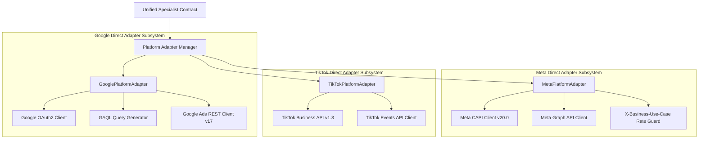

# Architecture Document 12: Platform Adapter Architecture
## Direct Platform Adapters: Google OAuth2, Meta System User & TikTok API

**Version:** 2.0.0 (Direct Integration Rewrite)  
**Phase:** 1 (Enterprise Architecture Deliverable)  
**Standard:** Native Platform Adapters without Third-Party Middleware

---

### 1. Adapter Architecture Overview

The `PlatformAdapter` layer decouples DigiPort's unified marketing domain from platform-specific SDKs, wire protocols, and error codes:

---

### 2. Deep Dive: Platform Authentication & Wire Protocols

#### 1. Google Ads Platform Adapter
* **Authentication Method:** OAuth2 User Consent / Service Refresh Token.
* **Header Structure:**
  * `Authorization: Bearer <access_token>`
  * `developer-token: <GOOGLE_ADS_DEVELOPER_TOKEN>`
  * `login-customer-id: <GOOGLE_ADS_LOGIN_CUSTOMER_ID>` (required if accessing accounts under an MCC / Manager Account).
* **Automatic Token Refresh:** When an API call returns `UNAUTHENTICATED` (HTTP 401), the adapter invokes `ICredentialManager.refreshOAuthToken('GOOGLE', clientId)`, caches the fresh token, and retries the request once.

#### 2. Meta Marketing Platform Adapter
* **Authentication Method:** Long-Lived System User Access Token (`META_ACCESS_TOKEN`).
* **Header Structure:** `Authorization: Bearer <META_ACCESS_TOKEN>`.
* **Rate Limit Monitoring:** Meta returns rate limits in the response header `X-Business-Use-Case-Usage`. The adapter parses `call_count`, `cpu_time`, and `total_time`. If any metric exceeds 80%, the adapter throttles subsequent calls with exponential backoff.

#### 3. TikTok Business Platform Adapter
* **Authentication Method:** Permanent / Long-Term Advertiser Access Token (`TIKTOK_ACCESS_TOKEN`).
* **Header Structure:** `Access-Token: <TIKTOK_ACCESS_TOKEN>`.
* **API Version:** TikTok Marketing Open API `v1.3`.

---

### 3. Error Translation & Unified Status Mapping

Platform adapters translate heterogeneous error codes into uniform DigiPort exceptions:

| Platform Error Condition | Raw Error Code | DigiPort Unified Exception | Action Taken |
|---|---|---|---|
| **Google Expired Token** | `UNAUTHENTICATED (HTTP 401)` | `TokenExpiredException` | Trigger OAuth refresh and retry |
| **Meta Rate Limit Exceeded** | `Error 17 / User Request Limit` | `RateLimitExceededException` | Backoff 60s, notify queue |
| **TikTok Budget Lower Than Min** | `Error 40002` | `InvalidParameterException` | Return clear validation error |
| **Google Policy Violation** | `POLICY_VIOLATION` | `AdPolicyViolationException` | Halt campaign, require human review |
| **Meta Creative Rejected** | `AD_REVIEW_DECLINED` | `AdPolicyViolationException` | Notify marketer via Telegram |
