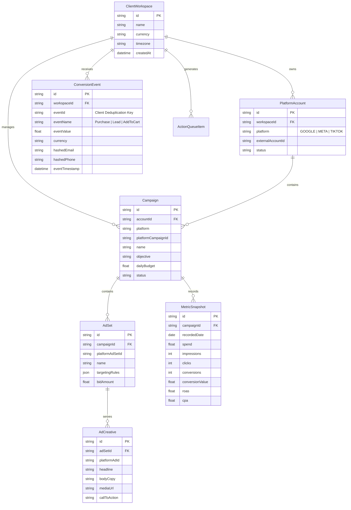

# Architecture Document 13: Cross-Platform Data Model
## Entity Relationship Diagram, Normalized Metrics & Attribution Model

**Version:** 2.0.0  
**Phase:** 1 (Enterprise Architecture Deliverable)  
**Standard:** Cross-Platform Normalized Schema & Attribution Modeling

---

### 1. Cross-Platform Relational ERD

---

### 2. Normalized Metric Standard Definitions

Across Google Ads, Meta Ads, and TikTok Ads, metrics have varying names (e.g. `cost` in Google vs `spend` in Meta). DigiPort standardizes them to the following:

| Unified Metric | Google Ads Metric | Meta Marketing API Metric | TikTok Ads Metric | Formula / Standard |
|---|---|---|---|---|
| **Spend** | `metrics.cost_micros / 1e6` | `spend` | `stat_cost` | Total monetary spend in account currency |
| **Impressions** | `metrics.impressions` | `impressions` | `show_cnt` | Number of times ads were displayed |
| **Clicks** | `metrics.clicks` | `clicks` (link_clicks) | `click_cnt` | Count of clicks navigating to landing page |
| **CTR** | `metrics.ctr` | `inline_link_click_ctr` | `ctr` | `(Clicks / Impressions) * 100` (%) |
| **CPC** | `metrics.average_cpc / 1e6` | `cpc` | `cpc` | `Spend / Clicks` |
| **Conversions** | `metrics.conversions` | `actions.purchase` | `conversion` | Validated tracked business outcomes |
| **CPA** | `metrics.cost_per_conversion` | `cost_per_action_type` | `cost_per_conversion` | `Spend / Conversions` |
| **ROAS** | `metrics.conversions_value / cost` | `purchase_roas` | `roas` | `Conversion Value / Spend` |
| **Blended ROAS** | — | — | — | `Sum(All Platform Revenue) / Sum(All Platform Spend)` |

---

### 3. Multi-Touch Attribution Model

DigiPort supports cross-platform attribution normalization:
1. **Deduplicated Last-Touch Attribution:** Default operational model. Attributes conversion to the ad platform that recorded the final click within 7 days prior to `event_id` receipt.
2. **Linear Cross-Platform Blend:** Spreads conversion credit equally across touchpoints detected in Google GA4 and Meta CAPI.
3. **Event Deduplication Algorithm:**  
   Every client web event emits a UUID `event_id`. When received simultaneously by browser pixels and DigiPort server CAPI, the server tags the event with `event_id`, ensuring Meta and TikTok deduplicate the event and prevent double-counted conversions.
