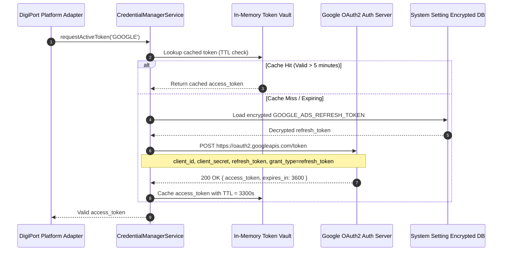

# Architecture Document 14: Credential & Token Management
## Environment Variable Contract, OAuth Lifecycle & Token Management Engine

**Version:** 2.0.0 (Direct API Specification)  
**Phase:** 1 (Enterprise Architecture Deliverable)  
**Standard:** Dedicated Credential Manager Specification & OAuth Lifecycle

---

### 1. The 14 Platform Credential Environment Variable Contract

The `CredentialManagerModule` reads and validates 14 canonical platform environment variables:

| Platform | Environment Variable | Required | Description |
|---|---|:---:|---|
| **Google** | `GOOGLE_ADS_DEVELOPER_TOKEN` | Yes | Approved Google Developer Token for Ads API access |
| **Google** | `GOOGLE_ADS_CLIENT_ID` | Yes | OAuth2 Client ID from Google Cloud Console |
| **Google** | `GOOGLE_ADS_CLIENT_SECRET` | Yes | OAuth2 Client Secret from Google Cloud Console |
| **Google** | `GOOGLE_ADS_REFRESH_TOKEN` | Yes | Long-term offline refresh token for user account |
| **Google** | `GOOGLE_ADS_CUSTOMER_ID` | Yes | Target 10-digit Google Ads Account ID (without dashes) |
| **Google** | `GOOGLE_ADS_LOGIN_CUSTOMER_ID` | Conditional | MCC / Manager Account ID if client is managed under MCC |
| **Google** | `GA4_PROPERTY_ID` | Yes | Google Analytics 4 Property ID for attribution verification |
| **Google** | `GTM_ACCOUNT_ID` | Yes | Google Tag Manager Account ID |
| **Google** | `GTM_CONTAINER_ID` | Yes | GTM Web / Server Container ID (e.g. GTM-PLX982K) |
| **Meta** | `META_ACCESS_TOKEN` | Yes | Long-Lived System User Access Token (Graph API v20.0) |
| **Meta** | `META_AD_ACCOUNT_ID` | Yes | Target Ad Account ID (e.g. act_1092847192) |
| **Meta** | `META_PIXEL_ID` | Yes | Meta Pixel ID for Conversions API (CAPI) events |
| **TikTok** | `TIKTOK_ACCESS_TOKEN` | Yes | Long-term Advertiser Access Token |
| **TikTok** | `TIKTOK_ADVERTISER_ID` | Yes | Target TikTok Business Advertiser ID |

---

### 2. OAuth2 Token Lifecycle Sequence

---

### 3. Scope Validation & Failure Recovery Modes

1. **Permission Scope Auditing:**  
   When credentials are saved or verified in `PlatformConnectionHubModal`, the system calls each platform's token inspection endpoint:
   * **Meta:** `GET /debug_token?input_token={token}` — checks `is_valid` and permissions array (`ads_management`, `business_management`).
   * **Google:** `POST https://oauth2.googleapis.com/tokeninfo?access_token={token}` — checks scope list.
   * **TikTok:** `GET /open_api/v1.3/oauth2/advertiser/get/` — verifies advertiser account access.

2. **Failure Modes & Automated Recovery:**
   * **Expired Refresh Token:** If Google OAuth returns `invalid_grant`, the adapter marks Google as `REAUTH_REQUIRED` and dispatches a high-priority Telegram alert to the marketer with an OAuth reconnect link.
   * **Rate-Limit Backoff:** If Meta returns `Error 17` (User request limit reached), the `CredentialManager` enforces exponential backoff: $T = 2^n \times 1000\text{ms}$ up to 60 seconds.
   * **Decryption Failure:** If `ENCRYPTION_SECRET` changes or corrupted data is detected, credentials are never exposed in plaintext; an error is logged with code `ERR_CRYPTO_INTEGRITY`.
