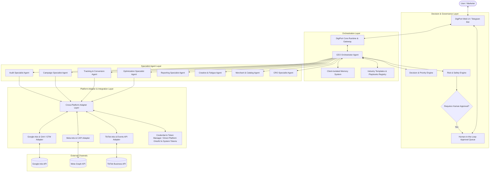
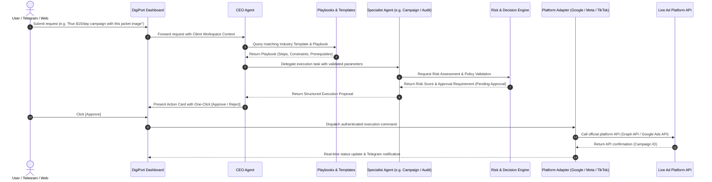

# DigiPort Enterprise Architecture Blueprint
## Autonomous Multi-Agent Marketing & Growth Operating System
**Version:** 1.0.0  
**Target Platforms:** Google Ads, Meta Ads (Facebook & Instagram), TikTok Ads  
**Governance:** Enterprise Agentic Operating Model (Phases 1–17)

---

## 1. System Overview & Core Philosophy
DigiPort is an enterprise-grade autonomous marketing platform designed to ingest multi-channel ad performance data, orchestrate specialized AI agents, enforce human-in-the-loop safety rails, and optimize cross-platform return on ad spend (ROAS).

### Core Architectural Separation of Concerns
1. **CEO Agent (Orchestration Only):** Responsible for parsing user objectives, identifying target platforms, assembling execution plans from Playbooks and Industry Templates, validating risk, and delegating execution. **The CEO Agent never calls platform APIs directly.**
2. **Specialist Agents (Execution Only):** Domain-specific agents (Audit, Campaign, Tracking, Optimization, Reporting, CRO, Merchant & Catalog, Creative). Specialist agents execute assigned tasks via Direct Platform Adapters (Official Platform APIs via Credential Manager), return structured outputs, and never make unvetted business decisions.
3. **Decision & Risk Engines (Validation & Guardrails):** Enforces budget caps (±20% daily scaling limit), detects policy constraints (Healthcare, Finance, Real Estate), calculates confidence scores, and constructs rollback plans.
4. **Platform Adapters & Cross-Platform Normalization:** Translates unified data models into platform-specific API payloads for Google Ads, Meta Marketing API, and TikTok Business API.

---

## 2. High-Level Component Diagram



---

## 3. Execution Flow & Lifecycle



---

## 4. Asset Repository Structure (`/assets/`)
As mandated by Phase 1 and Phases 5–14, static and version-controlled knowledge assets are organized strictly as follows:

```
/assets/
├── industry-templates/          # E-commerce, Lead Gen, Healthcare, SaaS, Real Estate, etc.
├── playbooks/                   # Execution workflows
│   ├── google/                  # PMax, Search, Shopping, Demand Gen playbooks
│   ├── meta/                    # Advantage+ Sales, Leads, Retargeting playbooks
│   ├── tiktok/                  # Spark Ads, Video Shopping, Lead Gen playbooks
│   └── cross-platform/          # Cross-channel budget allocation & creative testing
├── knowledge/                   # Static official documentation & best practices
│   ├── google/                  # Google Ads, GA4, GTM, Merchant Center
│   ├── meta/                    # Meta Marketing API, CAPI, Ad Standards
│   ├── tiktok/                  # TikTok Ads, Events API, Policies
│   └── cross-platform/          # Attribution, EMQ, Deduplication, Privacy
├── prompt-templates/            # Reusable reasoning prompt templates
├── agent-capabilities/          # Formal capability contracts per agent
│   ├── google/
│   ├── meta/
│   ├── tiktok/
│   └── cross-platform/
├── report-templates/            # Executive, Channel-specific, and CRO report schemas
├── report-scoring/              # Deterministic audit scoring algorithms
├── schedules/                   # Cron definitions, heartbeat configs, intervals
└── workflows/                   # State machine definitions for pipeline execution
```

---

## 5. Core Operational Policies

### 5.1 CEO Agent Policy
- The CEO Agent is strictly an orchestrator. It parses incoming natural language intents, verifies workspace identity, selects corresponding Playbooks, and builds an execution graph.
- **Rule:** The CEO Agent must NEVER call Google, Meta, or TikTok APIs directly.
- **Rule:** The CEO Agent interacts exclusively through validated TypeScript interface contracts.

### 5.2 Multi-Client Workspace Isolation Policy
- Every client business (e.g., `FakeIt`, `Brand B`) is completely isolated.
- Storage keys, chat conversations, ad accounts, OAuth credentials, and memory items are partitioned strictly by `workspaceId` and `slug`.
- Cross-client contamination is prevented by cryptographic boundaries and database foreign key cascades.

### 5.3 Memory Policy (Phase 8 Compliance)
- **Allowed in Memory:** Client business goals, brand voice, target CPA/ROAS preferences, naming conventions, approval rules, preferred platform ratios.
- **Strictly Prohibited in Memory:** Performance metrics, raw ad account dumps, API access tokens, client credentials, customer PII.
- Memory must be isolated per client and versioned deterministically.

### 5.4 Risk Engine & Budget Protection Policy (Phase 11 Compliance)
- **Daily Budget Scaling Guardrail:** Maximum allowable single-day budget change is capped at ±20%.
- **High-Risk Actions:** Pausing active campaigns with ROAS > 3.0x or deleting entities requires explicit two-step confirmation.
- **Rollback Guarantee:** Every modifying action (`WRITE`) must generate a deterministic rollback step before execution.

### 5.5 Platform Rate Limiting & Quota Policy
- Exponential backoff with jitter on API rate limit responses (HTTP 429).
- Google Ads API query limits and Meta Graph API call count quotas are monitored continuously.

---

## 6. Official Documentation Baseline
All agent knowledge modules, playbooks, and templates derive strictly from verified official documentation:
- **Google Ads:** `support.google.com/google-ads/` (PMax, Bidding, Conversions)
- **GA4 & GTM:** `support.google.com/analytics/` & `support.google.com/tagmanager/`
- **Meta Ads:** `developers.facebook.com/docs/marketing-apis` & `transparency.meta.com/policies/ad-standards`
- **TikTok Ads:** `business-api.tiktok.com/portal/docs` & `ads.tiktok.com/help`
