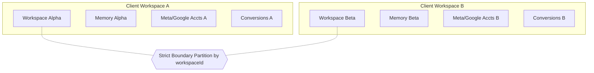

# System Policy P12: Multi-Client Isolation Policy
## Tenant Isolation, Workspace Boundaries & Anti-Contamination Rules

**Status:** APPROVED (Phase 1 Deliverable)  
**Applies To:** Core Runtime, Database Layer, Memory Manager & Platform Adapters  
**Standard:** Enterprise Multi-Tenant Data Isolation Standard

---

### 1. Purpose & Core Security Principle
DigiPort is an agency-grade, multi-client marketing operating system. This policy establishes absolute isolation between independent client workspaces (`ClientWorkspace`) to prevent data contamination, cross-client memory leakage, or accidental spend misallocation.

### 2. Tenant Isolation Invariants

1. **Relational Tenant Partitioning:**  
   Every database query for campaigns, metrics, actions, or credentials must explicitly filter by `workspaceId` (or `clientId`). Global, unfiltered `findMany()` queries without client constraints are strictly forbidden in production routes.
2. **Memory System Isolation:**  
   The `MemoryManager` scopes long-term context strictly by client partition. When generating AI prompts for Client A, the system is cryptographically and logically prohibited from injecting memory or brand strategies belonging to Client B.
3. **Platform Credential Separation:**  
   Platform tokens are stored with direct linkage to a specific `workspaceId`. A task executing on behalf of Client A cannot access the `META_ACCESS_TOKEN` or `GOOGLE_ADS_CUSTOMER_ID` of Client B.
4. **Chat & Conversation Scoping:**  
   Chat history and Copilot conversations are partitioned per client workspace in localStorage and database storage (`/api/ai/conversations?workspace=...`).

### 3. Auditing & Violation Enforcement
Any attempt to query cross-client entities without explicit administrative super-user privileges triggers a `SecurityViolationAlert` sent directly to the root audit log.
