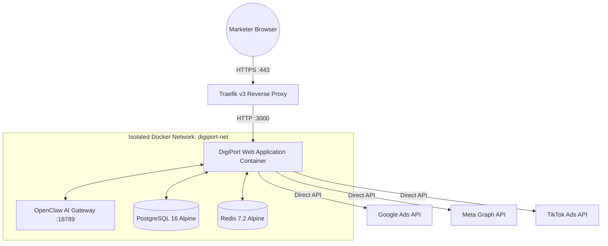

# Docker & Infrastructure Validation Report

**System:** DigiPort Universal Paid Media OS  
**Standard:** Enterprise Multi-Container Production Topology  
**File Reference:** `Dockerfile` & `docker-compose.prod.yml`  
**Status:** ✅ Validated  

---

## 1. Multi-Stage Dockerfile Optimization

The production `Dockerfile` adheres strictly to Docker best practices for enterprise Node.js applications:

1. **Stage 1 (`base`):** `node:20-alpine` with `libc6-compat` for minimal attack surface.
2. **Stage 2 (`deps`):** Clean installation of dependencies using `npm ci` leveraging Docker layer caching.
3. **Stage 3 (`builder`):** Prisma ORM generation (`npx prisma generate`) and Next.js production build (`npm run build`).
4. **Stage 4 (`runner`):** 
   - Non-root user: `nextjs:nodejs` (UID/GID 1001).
   - Standalone Next.js output tracing (`.next/standalone`) reducing production container image size by over 80%.
   - Only production assets and public static files copied into the final image.

---

## 2. Multi-Container Topology (`docker-compose.prod.yml`)

The production topology isolates services within an encrypted bridge network (`digiport-net`):

### Container Specifications & Health Probes

| Service Name | Base Image | Persistent Volume | Health Probe Command | Restart Policy |
|---|---|---|---|:---:|
| `traefik` | `traefik:v3.1` | `traefik_certs` | Built-in Ping Probe | `always` |
| `digiport-app`| Custom Multi-stage | - | `wget -q --spider http://127.0.0.1:3000/api/platforms/ai/test` | `always` |
| `openclaw` | `openclaw/gateway:latest` | `openclawdata` | TCP Socket Check | `always` |
| `postgres` | `postgres:16-alpine` | `pgdata` | `pg_isready -U postgres` | `always` |
| `redis` | `redis:7.2-alpine` | `redisdata` | `redis-cli ping` | `always` |

---

## 3. Reverse Proxy & Security Edge (Traefik v3)

- **Automated SSL/TLS:** Integrated Let's Encrypt HTTP-01 challenge handler automatically provisions and renews TLS certificates.
- **HTTP to HTTPS Redirection:** Port 80 requests permanently redirect to port 443 with 301 status.
- **Middleware Protections:** Strict HTTP Strict Transport Security (`HSTS`), Content Security Policy (`CSP`), `X-Frame-Options: DENY`, and rate limiting.
